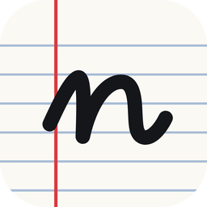
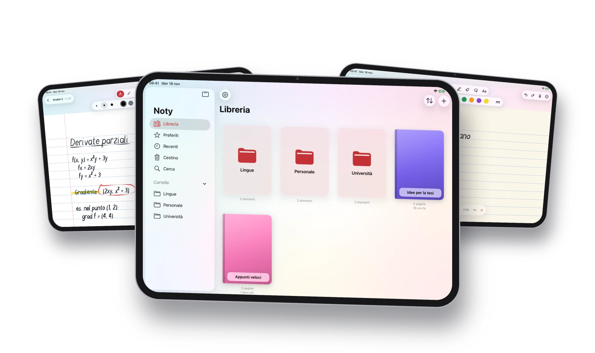
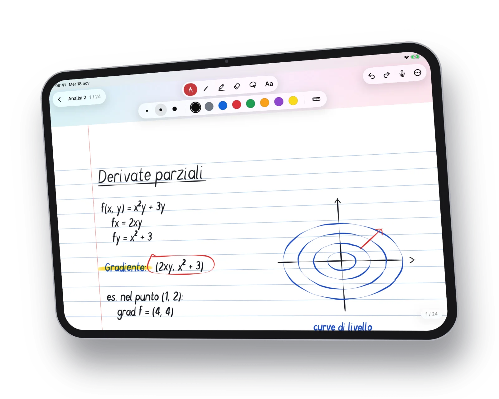
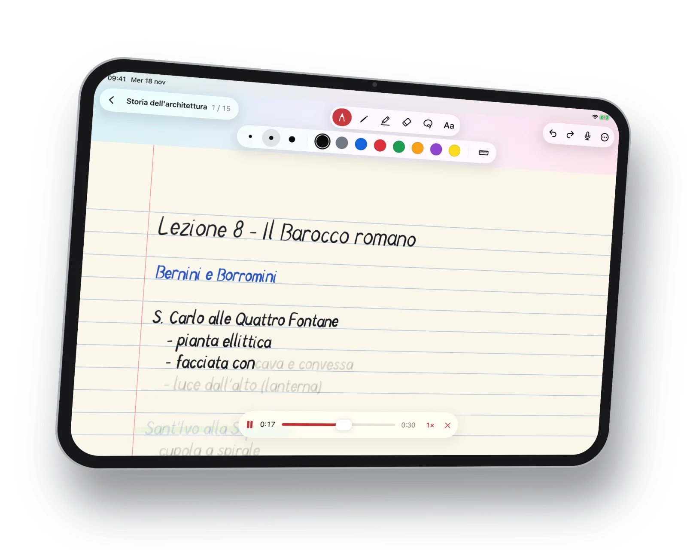
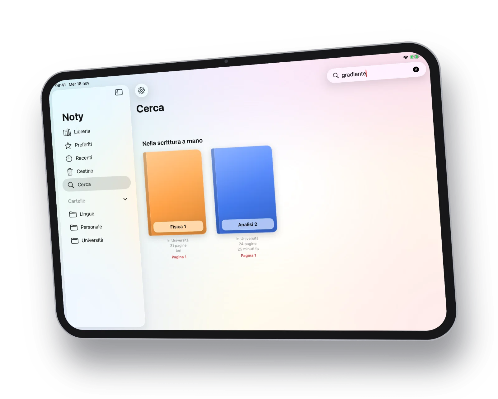

<p align="center">
  <picture>
    <source media="(prefers-color-scheme: dark)" srcset="docs/images/icon-dark.png">
    
  </picture>
</p>

<h1 align="center">Noty</h1>

<p align="center">
  Appunti a mano su iPad, con Apple Pencil.<br>
  Gratis per sempre: niente abbonamenti, pubblicità, account o limiti.
</p>

<p align="center">
  <a href="https://noty.paluello.me/#installa"><b>⬇ Installa con AltStore o SideStore</b></a>
  &nbsp;·&nbsp;
  <a href="https://github.com/Paluello/noty/releases/latest/download/Noty.ipa"><b>⬇ Scarica l'.ipa</b></a>
  &nbsp;·&nbsp;
  <a href="https://noty.paluello.me"><b>🌐 noty.paluello.me</b></a>
  <br>
  <sub>Versione 0.6.0 · iPad con iPadOS 18 o successivo · gratuita e open source (GPL-3.0)</sub>
  <br>
  <sub>Sorgente AltStore / SideStore: <code>https://noty.paluello.me/altstore.json</code></sub>
</p>

<p align="center">
  
</p>

Noty è un quaderno per Apple Pencil pensato per chi studia: apri e scrivi, registra la
lezione, ritrova quello che hai scritto. Tutte le funzioni sono per tutti, senza
scadenze, e i quaderni restano file tuoi, in un formato aperto e documentato.

## Funzioni

### ✍️ Scrivi come su carta
Penna, matita ed evidenziatore con la latenza nativa di Apple Pencil. Gomma parziale o a
tratto intero, lazo, righello e palette da otto colori. Tieni fermo il tratto e una linea
storta diventa dritta, un cerchio diventa un cerchio.

- Pagine A4 stampabili: bianche, a righe, a quadretti o a puntini, con la distanza che preferisci
- Caselle di testo con quattro grandezze ed elenchi puntati o numerati
- Immagini da Foto o File e scansione di documenti
- Le dita scorrono e zoomano, la Pencil scrive; zoom sempre nitido, fino al 30%
- Barra in Liquid Glass che fluttua sopra la pagina, e una modalità concentrazione che la nasconde

### 🎙️ Registra la lezione
Avvia la registrazione e continua a scrivere. Riascoltando, l'inchiostro segue la voce;
tocca un tratto e senti cosa si diceva in quel momento. La registrazione prosegue anche
con l'iPad in standby.

### 🔍 Ritrova quello che hai scritto
Cerca una parola e Noty la trova anche nella tua calligrafia, in tutti i quaderni, e apre
la pagina giusta. Il riconoscimento avviene sull'iPad: niente viene inviato altrove.

### 🗂️ Organizza centinaia di pagine
Cartelle e sottocartelle senza limiti, copertine colorate o con una tua foto, Preferiti e
Recenti, ordinamento per cartella. Due quaderni affiancati con Split View e Stage Manager.

### 📦 Porta via tutto, quando vuoi
Esporta un quaderno in PDF oppure tutta la libreria in un unico archivio, con i PDF e i
file originali. La libreria sta in una cartella che scegli tu: sull'iPad, su iCloud Drive
o su un NAS.

### 🔒 Privata per scelta
Nessun account, nessuna pubblicità, nessun tracciamento. Puoi bloccare l'app intera o un
singolo quaderno con Face ID.

<p align="center">
  
  
  
</p>

## Installare

### AltStore o SideStore (consigliato)
Per ora Noty si installa fuori dall'App Store, gratis, con il tuo Apple ID.

1. Installa [AltStore](https://altstore.io) o [SideStore](https://sidestore.io) sull'iPad.
2. Aggiungi la sorgente di Noty, così ricevi gli aggiornamenti:
   ```
   https://noty.paluello.me/altstore.json
   ```
3. Installa Noty dalla sorgente. In alternativa scarica `Noty.ipa` dall'ultima
   [release](https://github.com/Paluello/noty/releases/latest) e aprilo con AltStore.

Con un Apple ID gratuito la firma dura 7 giorni: AltStore la rinnova da solo quando l'iPad
è sulla stessa rete del computer con AltServer.

### App Store
Arriverà quando le donazioni ricorrenti copriranno i 99 € annui dell'Apple Developer
Program ([ADR-0022](docs/adr/0022-eccezione-app-store.md)). Vedi [Sostieni](#sostieni).

### Da sorgente
Apri `Noty.xcodeproj` con Xcode 26, scegli un iPad o il simulatore e premi Run. I dettagli
sono in [CONTRIBUTING.md](CONTRIBUTING.md).

## Sostieni
Noty resterà sempre gratuita. Se vuoi aiutare con le spese (Apple Developer Program,
dominio, server) puoi donare su [Open Collective](https://opencollective.com/paluello-me):
entrate e spese sono pubbliche.

## Segnalare un problema o proporre un'idea
- Qualcosa non funziona? Apri una [segnalazione di bug](https://github.com/Paluello/noty/issues/new?template=bug.md).
- Hai un'idea? Apri una [proposta](https://github.com/Paluello/noty/issues/new?template=feature.md).
  Prima dai un'occhiata alla [visione](docs/vision.md): Noty vuole restare semplice.

## Contribuire
Il codice è aperto e i contributi sono benvenuti: leggi [CONTRIBUTING.md](CONTRIBUTING.md).
Per capire com'è fatta l'app c'è la [guida alla documentazione](docs/README.md).

<details>
<summary><b>In English</b></summary>

**Noty** is a free, open source handwriting notes app for iPad and Apple Pencil, made for
students. No subscriptions, ads, accounts or limits, ever.

- Pencil-first writing with pen, pencil, highlighter, eraser, lasso, ruler and shape recognition
- Printable A4 pages, text boxes, images and document scanning
- Lecture recording synced with your ink: tap a stroke to hear what was being said
- On-device handwriting search across all notebooks
- Unlimited folders, favorites and recents, Split View and Stage Manager
- PDF export and "export everything"; your library lives in a folder you choose (iPad, iCloud Drive, NAS) in an open, documented format

**Install:** add the source `https://noty.paluello.me/altstore.json` to AltStore or
SideStore, or download `Noty.ipa` from the [latest release](https://github.com/Paluello/noty/releases/latest).
Requires iPadOS 18 or later (Liquid Glass on iPadOS 26 and later). The app is localized in English and Italian; project docs are in
Italian for now and will be translated before 1.0 ([ADR-0015](docs/adr/0015-localizzazione-e-lingua-docs.md)).
Code, issues and commits are in English. Support the project on
[Open Collective](https://opencollective.com/paluello-me).

</details>

---

Licenza [GPL-3.0-or-later](LICENSE) con un [permesso aggiuntivo per l'App Store](LICENSE-EXCEPTION.md)
([ADR-0011](docs/adr/0011-licenza-gpl.md), [ADR-0022](docs/adr/0022-eccezione-app-store.md)).
